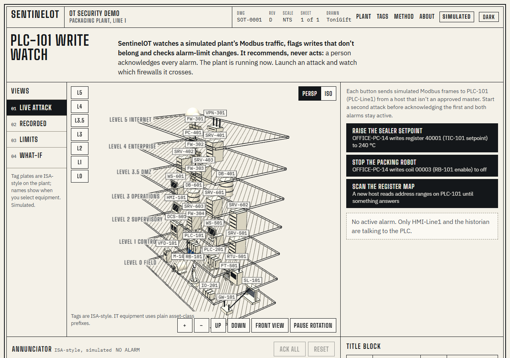
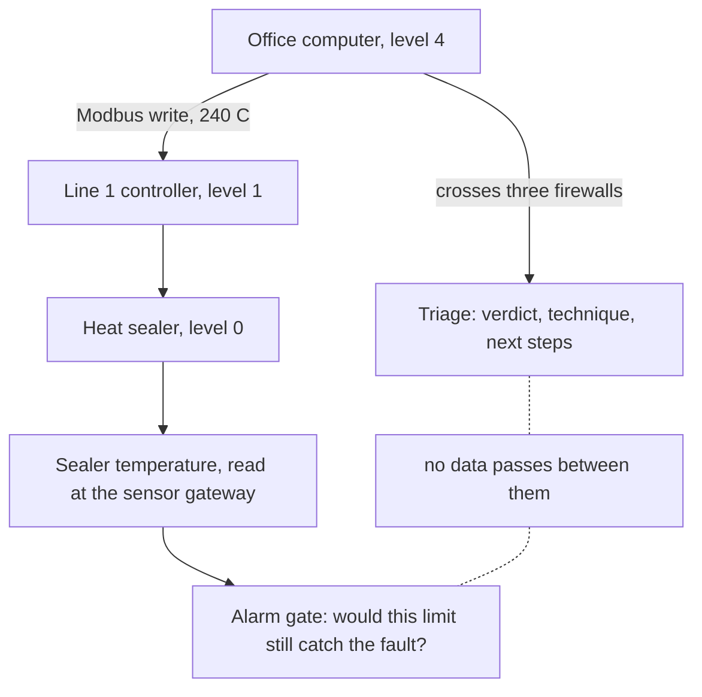

<!-- image to be supplied by the author -->


# SentinelOT Platform

A factory floor, drawn in 3D in your browser, with two kinds of trouble happening on it. Someone on the office network sends a command the machines should never receive. Somewhere else, an engineer widens an alarm limit, and a fault that used to raise an alarm quietly stops raising one. This project watches for both, explains what it sees in ordinary words, and shows you where on the plant it is happening.

**It recommends. It never acts.** Nothing here writes to a control network, blocks a connection, changes a setting on a controller or deploys anything. Every suggestion is marked either read-only or needs operator approval, and a person decides. The plant, the machines, the network traffic and the sensor readings are all invented and simulated, and the pages say so where you see them.

## Try it in two minutes

Start it with the commands under [Running it yourself](#running-it-yourself), then open the plant page at `/sentinelot.html`. Nothing you do here touches anything real.

1. **Look around.** Drag the plant to turn it. The stack of grey slabs is the factory, drawn as layers: machines at the bottom, offices and the internet at the top. Press **Front view** to face it straight on, or **Rotate plant** to let it turn by itself.
2. **Watch the traffic.** The panel at the bottom right lists messages passing between the machines. These are Modbus/TCP frames, the language many controllers speak. Two computers are allowed to talk to the line 1 controller: the operator's screen and the historian that records readings.
3. **Send the first attack.** On the **Live** tab, press **Raise the sealer setpoint**. An office computer with no business writing to a controller sets the heat sealer to 240 °C. An alarm appears, the plant draws the path the command took, and the firewalls it crossed light up.
4. **Read the alarm.** It names the source, the target, the rule that fired and the firewalls crossed, then explains in three short paragraphs what happened, what it could do to the process, and what to do first.
5. **Try the other two.** **Stop the packing robot** switches a robot off. **Scan the register map** is a new computer feeling around the controller for addresses that answer. **Acknowledge and restore** puts the plant back.
6. **See a recorded verdict.** The **Recorded** tab holds eight alerts the triage pipeline has already judged. Pick one and the plant traces that alert too.
7. **Check an alarm limit.** On the **Limits** tab, press **Widen the sealer high limit to 250 °C**. The answer comes back **Blocked**, with the detection rate before and after, and a list of the faults that change would stop catching.
8. **Break the process yourself.** On the **What-if** tab, drag the sealer setpoint up. The sealing bars glow orange, then red, and a line appears: *Film burns on the bars*. Push the conveyor past 1,500 rpm and packs pile up behind the robot. Fill the tank to 100% and it overflows. Empty it and the pump runs dry.
9. **Compare two sets of limits.** Still on **What-if**, press **Propose sealer high 250 °C**, then set the sealer to 230 °C. The table shows the current limits raising **High high** and the proposed limits raising nothing, with a sentence spelling out what that would mean.
10. **Move the camera.** Press **L0** to drop to the field machines, or **L5** for the internet. Hold Shift and drag to slide the view, or use **Up** and **Down**. On a phone, two fingers move it; one finger still scrolls the page.

## Why draw it in 3D

A list of alerts tells you that a computer at one address wrote to a controller at another address. It does not tell you that those two sit six layers apart, that three firewalls stand between them, or that the controller runs the machine sealing the bags.

Industrial networks are built as layers on purpose. Equipment that touches the product sits at the bottom, office computers at the top, and every boundary is there to stop traffic that should not cross it. An alert matters mostly because of where its two ends sit in that stack, and what had to be passed to get from one to the other.

Drawing the plant as layers puts that on screen. When an attack fires, a line climbs down through the levels and the firewalls it crossed change colour. When a proposed alarm limit would stop catching a fault, the machine that fault belongs to lights up, so an edit to a number in a configuration file lands on a physical thing.

## The plant, level by level

Industrial networks are usually described with the Purdue model, which numbers the layers from 0 at the machines to 5 at the internet. The plant here is a fictional packaging factory that follows that numbering.

Items marked **demo** were added to make the page worth looking at. They are not in the inventory the triage pipeline uses, which holds the fourteen assets in [`data/assets.json`](data/assets.json).

| Level | What it is | What sits here |
|---|---|---|
| **5 internet** | Outside the company | INTERNET (demo); VPN-GW-01, the gateway staff and suppliers dial into (demo) |
| **4 enterprise** | The office network | OFFICE-PC-14, an ordinary desk computer; ERP-SRV-01, which holds orders and production plans (demo) |
| **3.5 DMZ** | A buffer between office and plant | JUMP-SRV-01, the single door into the plant network; PATCH-SRV-01, which stages approved updates; HIST-DMZ-01, a read-only copy of plant data for the office |
| **3 operations** | Plant-wide systems | ENG-WS-01, the workstation that programs controllers; HIST-01, which records every reading; MES-SRV-01, which schedules production (demo); AD-OT-01, which holds the plant's logins (demo) |
| **2 supervisory** | The screens operators watch | HMI-Line1, the touchscreen beside line 1; SCADA-SRV-01, which gathers data from the whole plant; DCS-OPS-01 and DCS-SRV-01, the console and server for the utilities (both demo) |
| **1 control** | The computers that run the machines | PLC-Line1 and PLC-Line2, the controllers for the two packaging lines; RTU-Outstation-3, which reports utility meter readings; DCS-CTRL-01, a controller pair for steam, air and chilled water (demo) |
| **0 field** | The machines and sensors themselves | SEALER-Line1, which heat-seals the film (demo); VFD-Conveyor-1 and the motor it drives, MOTOR-Conveyor-1 (motor is demo); ROBOT-Pick-1, which packs product into cases (demo); IO-Module-Line2; SENSOR-GW-1, which carries the sealer temperature readings; TANK-Utility-1, PUMP-Utility-1 and FLOW-Meter-1 for the chilled water (all demo) |

Some words that appear on the page. A **PLC** is a small rugged computer that runs one machine or line. A **DCS** does the same job for a continuous process such as steam or cooling. An **HMI** is the screen an operator uses. An **RTU** is a controller in a remote spot that reports back. A **historian** stores readings so people can look at yesterday.

Four firewalls stand between the levels, drawn on the column at the left of the plant. All four are demo additions.

| Firewall | Between | What it is meant to stop |
|---|---|---|
| FW-Edge | Levels 5 and 4 | Anything from the internet except the VPN gateway and ordinary web browsing |
| FW-IT-DMZ | Levels 4 and 3.5 | Office computers reaching past the buffer zone |
| FW-DMZ-OT | Levels 3.5 and 3 | Any direct path from the office network to the plant floor |
| FW-Cell-1 | Levels 2 and 1 | Anything but the operator screen, the historian and the engineering workstation reaching the line 1 controller |

The attack in the guided tour starts at an office computer on level 4 and ends at a controller on level 1. It crosses three of those four, which is why the alarm lists them.

## Two problems on one plant

The two halves of this project answer different questions about the same factory.

**Someone sends a command that should not arrive.** A monitoring tool raises an alert. Judging it takes knowledge of the equipment, of the protocol, of what attackers do to industrial systems, and of what the machine would physically do next. That is the triage half, and it came from a project called SentinelOT.

**Someone changes an alarm limit and nobody measures it.** A limit is the reading at which the control system calls for a person: a tank too full, a sealer too hot. Limits get edited over the years. Set them too wide and a real fault passes in silence. Set them too narrow and operators are buried in alarms they learn to ignore. That is the AlarmOps half, and it came from a project of that name.

The page joins them through one number. The attack raises the sealer setpoint to 240 °C. What would catch that, if nobody were watching the network at all, is the sealer's 190 °C high alarm. The **Limits** and **What-if** tabs let you try widening that same limit to 250 °C, and the gate refuses, because five labelled faults would stop being caught.

**What is not connected:** the attack is never sent to AlarmOps, and AlarmOps never looks at network traffic. No data passes between the two halves. The page shows that the limit one half protects is the limit the other half leans on, and nothing more.



## How the pieces work

### The triage pipeline

Five agents run in a fixed order, each one a model call that has to return a known shape of answer.

| Order | Agent | What it produces |
|---|---|---|
| 1 | Intake | A summary, the addresses, protocols, function codes and CVEs it found, search terms, and a flag if the alert text tries to give the AI orders |
| 2 | Intel | A short read of the threat-intelligence results, citing only pages that were actually fetched |
| 3 | ATT&CK mapper | Techniques chosen from the published MITRE ATT&CK for ICS list |
| 4 | Triage analyst | The verdict, the priority, a confidence, the likely effect on the process, and the evidence behind it |
| 5 | Response advisor | Next steps, each marked read-only or needs operator approval |

After each step, plain code checks the answer before anything is passed on. It deletes citations whose links were never retrieved. It deletes technique IDs that do not appear in the ATT&CK data file, and takes the names from the file. It insists the verdict and the priority agree, retries once if they do not, and falls back if the retry fails. It removes evidence pointing at an empty field. It flags instructions hidden in the alert text. Every call has a timeout and one retry.

Those checks are code rather than another model call because the mistakes they catch are the ones a model is worst at noticing in itself: a citation that reads perfectly and does not exist, a technique ID retired last year, a verdict that contradicts the priority written beside it. A short rule you can test is worth more here than a second opinion. The model proposes; the code decides what reaches the analyst.

Alerts arrive at `POST /api/triage` in the shape set out in [`triage/schemas.py`](triage/schemas.py). The fuller description is in [How it works](docs/HOW_IT_WORKS.md).

### The alarm-limit gate

AlarmOps measures a proposed limit instead of arguing about it.

- **The dataset.** A seeded generator writes 6,000 readings for each tag: a slow wave with noise, into which it injects faults of three kinds, spikes, drifts, and readings that freeze. Each fault is recorded with its start and end, so the file knows the right answer.
- **The replay.** The alarm logic runs across those readings with a given set of limits. A fault counts as caught if an alarm for that tag fires inside its window. An alarm outside every window counts as a false alarm.
- **The gate.** A policy file sets the floor: at least 90% of faults caught, no more than a 5 point drop against the limits in force, at most 3 false alarms, and no more than 2 extra. A change that breaks any of those is blocked, and the answer lists the faults it would have missed.
- **The paperwork.** In its own repository, AlarmOps runs that replay on every proposed edit through a GitLab pipeline, posts the measurement on the request, scans for credentials left in the file, writes a change record and a bill of materials, deploys to staging, waits for a person before production, and watches the alarm rate afterwards. That pipeline runs only in [ToniGift/AlarmOps](https://github.com/ToniGift/AlarmOps). It does not run here, and this repository carries out no staging, approval or deployment.

Three read-only routes expose the measuring part, defined in [`triage/alarm_limits.py`](triage/alarm_limits.py):

| Route | Answer |
|---|---|
| `GET /api/alarmops/baseline` | The limits in force, replayed, with every tag's faults and the equipment it belongs to |
| `GET /api/alarmops/compare` | One tag's edited limits, replayed and put through the gate: passed or blocked, and which faults are newly missed |
| `GET /api/alarmops/monitor` | A drift check over a bundled, simulated log of alarm counts after a release |

They accept GET only and store nothing. A proposed change exists only in the reply.

### The shared plant

[`plant/`](plant) is what ties the halves together. It holds the limits, the generated dataset, and a small file mapping each tag to the equipment it belongs to, written with the same names the 3D page draws. `sealer_temperature` is measured at SENSOR-GW-1 and read by PLC-Line1; `tank_level` sits at TANK-Utility-1 and is read by DCS-CTRL-01. That mapping is why a blocked limit change lights up a machine.

The folder keeps the three original AlarmOps tags and their readings byte for byte, and adds two of its own for the packaging line. [`alarmops/`](alarmops) is a copy of that repository, used as a library and left unmodified.

## The What-if sandbox

The **What-if** tab lets you drive the process. It is a **simplified demo model, not plant physics**, and the page says so beside the controls. The rules are these, and nothing more:

- The sealer temperature moves 6% of the way towards its setpoint on each step.
- Packs arrive in proportion to the conveyor speed: 42 a minute at the nominal 1,200 rpm. The robot picks at most 45 a minute, and anything above that becomes a backlog.
- The pump holds 5 bar while it is running and the tank is above 10%. Below that it runs dry and the pressure falls towards 1 bar. Switched off, it reads zero.
- The flow follows the pressure: 120 m³/h at 5 bar.

Four rules are enough to make the machines go wrong in ways you can see. The sealer burns the film. The conveyor outruns the robot. The tank overflows or empties. Every state is written out in words as well as shown in colour, and nothing flashes or shakes if your system asks for reduced motion.

The same readings are compared against two sets of limits side by side, the ones in force and the ones you propose, and the page names any alarm the proposed set would stay silent for. That comparison is instant: it ignores the deadband and the delay the real gate applies, which the page also states.

The sandbox runs entirely in the browser as plain functions, so it works with the page opened straight from a file. While its tab is open the live traffic pauses; leaving the tab puts the live plant back exactly as it was, including any alarm still showing.

## Measured results

Every number below was measured on 13 November 2026 from files in this repository, either by replaying the datasets or by reading the recorded evaluation runs. None of it comes from a real plant, a real network or a real lab.

### From the original hackathon runs

These come from the triage pipeline's recorded runs in [`results/`](results), produced before this repository existed. I re-derived them from those files rather than calling the models again.

| Measurement | Result |
|---|---|
| Fresh held-out set, 10 alerts, 3 runs each | 29 of 30 verdicts matched the label written before the run |
| The same runs, technique choice | 28 of 30 acceptable |
| Time per alert, across all 100 recorded runs | median 26.4 seconds; fastest 11.1, slowest 513.4 |

A prompt-injection test is reported in [Evaluation](docs/EVALUATION.md), but its raw output is not among the committed files, so I have not re-measured it and do not quote it here.

The alerts behind those runs are invented. They were written with AI assistance, then reviewed and run by me.

### From this repository

Measured now by replaying the datasets through the routes above.

The original AlarmOps dataset, 3 tags and 21 labelled faults:

| Limits | Result |
|---|---|
| As they stand | 21 of 21 faults caught, 0 false alarms |
| Tank widened to 88 / 95 | **Blocked.** 100% to 81.0%, 17 of 21, four tank faults missed |

The shared plant dataset, 5 tags and 35 labelled faults:

| Limits | Result |
|---|---|
| As they stand | 35 of 35 faults caught, 0 false alarms |
| Tank widened to 88 / 95 | **Blocked.** 100% to 88.6%, 31 of 35, the same four tank faults missed |
| Tank tightened to 75 / 88 | **Passes.** 35 of 35, 0 false alarms |
| Sealer high raised from 190 to 250 °C, high-high 205 to 265 | **Blocked.** 100% to 85.7%, 30 of 35, five sealer faults missed |

The two tables disagree on percentages because they count the same missed faults out of different totals. **The 14 extra faults were generated for this demo by the same seeded generator. They are not independent evidence of anything.** They exist so the sealer and the conveyor have something to be measured against.

Test suites, run now: 63 tests for the platform, 86 for the AlarmOps copy.

## Running it yourself

### Settings

Copy `.env.example` to `.env` and fill it in. Only the names appear here; keep the values to yourself and never commit the file. `.gitignore` already lists it.

| Setting | Needed for |
|---|---|
| `NEBIUS_API_KEY`, `NEBIUS_BASE_URL` | reaching the models |
| `TAVILY_API_KEY` | the threat-intelligence search |
| `MODEL_INTAKE`, `MODEL_INTEL`, `MODEL_MAPPER`, `MODEL_TRIAGE`, `MODEL_ADVISOR` | which model each agent uses; the server will not start while any is empty |
| `APP_ADMIN_TOKEN` | the header `POST /api/triage` requires |
| `DEMO_PER_IP_HOUR`, `DEMO_DAILY_CAP` | limits on the public demo buttons |
| `SITE_ADDRESS` | Docker only: `:80` for plain HTTP, or a domain name for automatic HTTPS |
| `ASSETS_FILE`, `SENTINELOT_URL`, `LAB_*` | the lab feeds only, described in [Lab alerts](docs/LABSHOCK.md) |

One setting is not in the example file: `ALARM_LIMITS_ROOT`. Set it to `alarmops` to replay the original dataset instead of the shared plant one. It defaults to `plant`.

The plant page and the alarm-limit routes need no keys at all. Only a triage run does.

### With Docker

Windows, in PowerShell:

```
copy .env.example .env
docker compose up --build
```

Linux or macOS:

```
cp .env.example .env
docker compose up --build
```

Then open:

| Address | Page |
|---|---|
| http://localhost | the triage interface |
| http://localhost/sentinelot.html | the 3D plant |

Stop it with Ctrl+C, then `docker compose down`.

If the build stops with `lookup registry-1.docker.io: no such host` while the rest of your machine resolves names normally, Docker's own network cannot reach a name server. Add a `dns` entry to Docker's configuration file, keeping whatever is already in it:

```json
{
  "dns": ["1.1.1.1", "8.8.8.8"]
}
```

On Windows that file is `%USERPROFILE%\.docker\daemon.json`; on Linux and macOS it is `/etc/docker/daemon.json`. Quit Docker Desktop from the tray and open it again afterwards.

### Without Docker

Windows, in PowerShell:

```
python -m venv .venv
.venv\Scripts\python -m pip install -r requirements.txt
copy .env.example .env
.venv\Scripts\python -m uvicorn triage.main:app --port 8000
```

Linux or macOS:

```
python3 -m venv .venv
.venv/bin/python -m pip install -r requirements.txt
cp .env.example .env
.venv/bin/python -m uvicorn triage.main:app --port 8000
```

Then open http://localhost:8000 and http://localhost:8000/sentinelot.html.

The platform imports AlarmOps directly, so there is no second service to start. The AlarmOps page and its own lab are a separate program: to run them, go to the `alarmops` folder, run `pip install -e .`, then `python -m alarmops.web`, and open http://localhost:8080.

The plant page also opens straight from the file system. The attacks, the 3D view and the What-if sandbox all work that way. Only the gate's **Check change** needs the server, and without it the Limits tab shows a saved answer marked as recorded.

### Tests

```
pip install -r requirements-dev.txt -r alarmops/requirements-dev.txt
python -m pytest
python -m pytest alarmops
```

The platform suite covers the API and its rate limits, the code checks, the orchestrator with the models stubbed out, the scenario labels, the lab feeds, the alarm-limit routes and every figure in the results tables, that the shared plant leaves the original dataset untouched, and that the saved answers in the page still match the routes. Sixteen of those tests drive the page itself in a headless browser and need Playwright and an installed Microsoft Edge (or Chrome), which they launch directly, so no browser download is needed. Playwright is in `requirements-dev.txt` and deliberately not in `requirements.txt`. Without them they are skipped, and `pytest.ini` turns on the summary that lists every skip with its reason, so a skipped test is never mistaken for a passing one. No test calls a model or reaches the network.

## Repository map

```
sentinelot-platform/
├── triage/        the server: five agents, the code checks, the API, the lab feeds, the alarm-limit routes
├── static/        two pages: index.html for triage, sentinelot.html for the 3D plant
├── plant/         alarm limits, the generated dataset, and the tag-to-equipment map
├── alarmops/      an unmodified copy of the AlarmOps repository, used as a library
├── data/          the fictional asset inventory, an empty lab inventory, the ATT&CK for ICS data
├── tests/         the platform tests, including the ones that drive the page
├── results/       the recorded evaluation runs behind the hackathon numbers
└── docs/          longer explanations and the images
```

Longer notes live in [About](docs/ABOUT.md), [How it works](docs/HOW_IT_WORKS.md), [Examples](docs/EXAMPLES.md), [Test plant](docs/TEST_PLANT.md), [Evaluation](docs/EVALUATION.md), [Lab alerts](docs/LABSHOCK.md), [Web interface](docs/WEB_INTERFACE.md), [Run it](docs/RUN_IT.md), [Testing](docs/TESTING.md), [Deploying](docs/DEPLOY.md), [Nemotron and Nebius](docs/NEMOTRON_AND_NEBIUS.md), and the [build notes](docs/NOTES.md).

## What this is not, and what comes next

This is a prototype. It has never seen a real plant, and nothing in it can reach one.

- Every alert is invented and every reading is generated. The numbers describe behaviour on made-up data.
- The lab feeds in [`triage/lab_elk.py`](triage/lab_elk.py) and [`triage/lab_sniffer.py`](triage/lab_sniffer.py) are written and unit tested, but have never been pointed at a lab. There is no lab result of any kind.
- Alert text is sent to a model over the internet. A plant that cannot allow that would need a model running locally, which has not been tried.
- The gate's thresholds are a choice somebody has to own, not a standard.
- The inventory is fourteen invented assets in one file. Real ones are larger, out of date and disputed.
- Put to work, this would still need a real alert source, an inventory somebody maintains, a trial against already-judged alerts, access control, an audit trail, and a decision about where the model runs.

What is planned:

1. **A run against the home lab.** The expected verdict for each planned attack is already written down in [`triage/scenarios_lab.py`](triage/scenarios_lab.py), before anything has been run, so the result cannot be adjusted afterwards.
2. **A feed from triage into the alarm gate.** Today a triage verdict about an alarm-related alert says nothing about whether the limits behind it still catch anything. It should.
3. **A trial in the shadows,** with permission, against alerts a company has already judged: their analyst's decision beside this one, nothing acted on.

## Credits and licence

The triage half began as SentinelOT, built for the Nebius x NVIDIA Global AI Hackathon. That submission is kept as it was at [ToniGift/sentinelOT](https://github.com/ToniGift/sentinelOT), and this repository was imported from it. The alarm half began as [ToniGift/AlarmOps](https://github.com/ToniGift/AlarmOps), built for the GitLab Transcend "Life After Code" hackathon, which remains the home of its pipeline.

- **MITRE ATT&CK® for ICS** supplies the technique list. ATT&CK® is a registered trademark of The MITRE Corporation, which has no connection with this project and does not endorse it. MITRE's terms are reproduced in [NOTICE.md](NOTICE.md).
- **NVIDIA Nemotron** models make the five agent calls, served through **Nebius Token Factory**, with the public demo hosted on **Nebius AI Cloud**. Details in [Nemotron and Nebius](docs/NEMOTRON_AND_NEBIUS.md).
- **Tavily Search API** supplies the threat-intelligence results.
- **three.js**, under the MIT licence, draws the plant. It is loaded from a CDN and not copied here.
- **Scapy**, under GPL-2.0, is an optional dependency of the Modbus sniffer, installed from PyPI and not copied here.

Released under the MIT licence; see [LICENSE](LICENSE). Where each part came from, and the terms covering it, are set out in [NOTICE.md](NOTICE.md).

Built by Anthony Afonughe, an OT/ICS security engineer.
