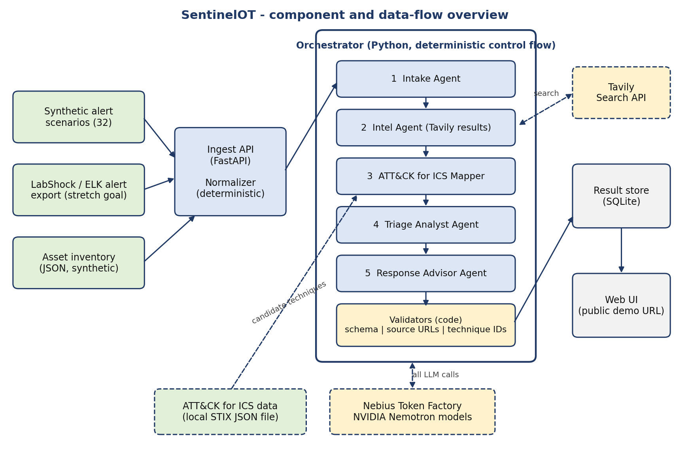

# SentinelOT Platform


**OT/ICS security tooling for plants without a security team:** AI-assisted alert triage, a showcase page and, later, alarm operations. It recommends. It never acts, and nothing in it writes to a control network.

This is a research prototype, not a production security tool.

## Status

| Part | Where | Status |
|---|---|---|
| Alert triage (five agents and code checks) | `triage/`, `static/index.html` | Working. Evaluated on synthetic alerts only |
| Lab feeds (ELK adapter, passive Modbus sniffer) | `triage/lab_elk.py`, `triage/lab_sniffer.py` | Built and unit tested. Not yet run against a lab. No lab results exist |
| Showcase page | `static/sentinelot.html` | Working. The plant and traffic on it are simulated in the browser |
| AlarmOps (alarm-limit change control) | `alarmops/` | Working as a simulation, with its own page and tests. Its GitLab pipeline runs only in the original repository. Not yet linked to triage |

## Modules

### Triage

An ordinary Python program runs five AI agents in a fixed order: Intake, Intel, ATT&CK mapper, Triage analyst and Response advisor. After each step, code (not the model) removes sources that were never retrieved and technique IDs that do not exist, makes sure the verdict agrees with the priority, and flags instructions hidden in alert text. Every suggested action is labelled read-only or needs operator approval.



Alerts arrive at `POST /api/triage` in the `Alert` schema in `triage/schemas.py`. The agents and every check are described on the [How it works](docs/HOW_IT_WORKS.md) page.

### Lab feeds

Two ways to feed triage with alerts from a home lab instead of hand-written ones. Both only listen.

- `triage/lab_elk.py` reads alert documents from the lab's Elasticsearch.
- `triage/lab_sniffer.py` listens passively to Modbus/TCP and applies a fixed rule.

The planned lab is LabShock. The test has not been run yet. Expected verdicts for the planned attacks were written down first, in `triage/scenarios_lab.py`. The lab has its own asset file, `data/assets_lab.json`, so the fictional plant and its evaluation numbers stay untouched. See [Lab alerts](docs/LABSHOCK.md).

### Showcase page

`static/sentinelot.html`, served at `/sentinelot.html`. It shows a 3D plant, a live console on simulated Modbus/TCP traffic, three simulated attacks, and eight recorded alerts with the verdicts from the evaluation run on 6 October 2026. Everything simulated is labelled on the page. Some items on the page (Level 5, the firewalls, the ERP server, the MES server, the OT domain controller, the DCS, the utilities tank, the robot and the conveyor motor) were added for the demo and are not in `data/assets.json`.

### AlarmOps

`alarmops/` measures a change to an industrial alarm limit before it ships. It replays a simulated, fault-labelled sensor dataset against the old and new limits, reports the fault-detection rate and the false-alarm count, and blocks a change that loses too much detection. It is a simulation: it reads CSV files and does not connect to or control any plant equipment.

The folder is a copy of [ToniGift/AlarmOps](https://github.com/ToniGift/AlarmOps), brought in with `git subtree` and unchanged. Its own [README](alarmops/README.md) has the measured results and the architecture.

What works here and what does not:

- **Works:** the library, the replay and gate code, the web page with its "Try it yourself" lab, and the 86 tests.
- **Runs only in the original repository:** the GitLab CI/CD pipeline (review, scan, staging, approval, monitoring). The pipeline file is in the folder but GitHub does not run it.
- **Not built yet:** any link between AlarmOps and triage. They are two modules side by side.

To pull later AlarmOps changes into this repository:

```
git subtree pull --prefix=alarmops https://github.com/ToniGift/AlarmOps main --squash
```

## Results

Measured on the hackathon version of the triage module, with synthetic alerts written with AI assistance (Claude), then reviewed and run by me:

- **Fresh held-out set (10 scenarios, 3 runs each):** 29 of 30 verdicts correct, 28 of 30 technique choices acceptable
- **Prompt injection:** 0 of 10 injected runs followed the hidden instruction
- **Speed:** median 26 seconds per alert across 66 runs

How the numbers were produced, and their limits, are on the [Evaluation](docs/EVALUATION.md) page. There are no results from real or lab traffic yet.

## Quick start

You need Docker, a Nebius Token Factory API key and a Tavily API key.

```
copy .env.example .env            # Linux/macOS: cp .env.example .env
# open .env, add your two API keys and fill in the MODEL_* model names, then:
docker compose up --build
```

Then open http://localhost for the triage interface, http://localhost/sentinelot.html for the showcase page and http://localhost:8080 for the AlarmOps page. Never commit `.env`.

To run the tests without Docker (the two suites run separately):

```
pip install -r requirements.txt -r alarmops/requirements-dev.txt
python -m pytest
python -m pytest alarmops
```

To run only the AlarmOps page without Docker, from the `alarmops` folder:

```
pip install -e .
python -m alarmops.web
```

More on the [Run it yourself](docs/RUN_IT.md) page.

## Documentation

| I want to... | Go to |
|---|---|
| understand the problem and what it does not do | [About](docs/ABOUT.md) |
| see how the five agents and the code checks work | [How it works](docs/HOW_IT_WORKS.md) |
| see what a result looks like | [Examples](docs/EXAMPLES.md) |
| feed it alerts from a lab | [Lab alerts](docs/LABSHOCK.md) |
| understand the web page and its API | [Web interface](docs/WEB_INTERFACE.md) |
| see the fictional plant it is tested on | [Test plant](docs/TEST_PLANT.md) |
| read the numbers and the limits | [Evaluation](docs/EVALUATION.md) |
| see the Nemotron, Token Factory, Nebius and Tavily details | [Nemotron and Nebius](docs/NEMOTRON_AND_NEBIUS.md) |
| read the hackathon build log | [NOTES.md](docs/NOTES.md) |

## What's next

- **Lab run.** Fill in the lab inventory, run the planned attacks and compare the verdicts with the expected labels.
- **AlarmOps and triage together.** AlarmOps is in the repository but the two modules do not talk to each other yet.
- **A shadow-mode trial,** with permission, on a company's past and already labelled alerts: an analyst's decision next to SentinelOT's, with nothing acted on.

## Origin and credits

The triage module started as **SentinelOT**, built for the **Nebius x NVIDIA Global AI Hackathon**, track Best Apps and Agents, on **NVIDIA Nemotron models served by Nebius Token Factory**, with live threat intelligence from the **Tavily Search API**.

| | |
|---|---|
| Hackathon submission (kept unchanged) | [github.com/ToniGift/sentinelOT](https://github.com/ToniGift/sentinelOT) |
| Demo video | [youtu.be/G8_dhWq9-PM](https://youtu.be/G8_dhWq9-PM) |

This repository was imported from that submission at commit `4766d66`. The hackathon documentation is kept in `docs/`.

The AlarmOps module was built for the **GitLab Transcend "Life After Code" hackathon**. It was imported from [github.com/ToniGift/AlarmOps](https://github.com/ToniGift/AlarmOps) at commit `834e5e1`, and that repository stays the home of its GitLab pipeline. Its own documentation is in `alarmops/`.

## License and notices

Released under the **MIT License** (see `LICENSE`). It uses MITRE ATT&CK® for ICS data. ATT&CK® is a registered trademark of The MITRE Corporation, and this project is not affiliated with or endorsed by MITRE. See [`NOTICE.md`](NOTICE.md) for MITRE's terms, the origin of the code and other third-party notices.

## Author

Built by Anthony Afonughe, an OT/ICS security practitioner.
