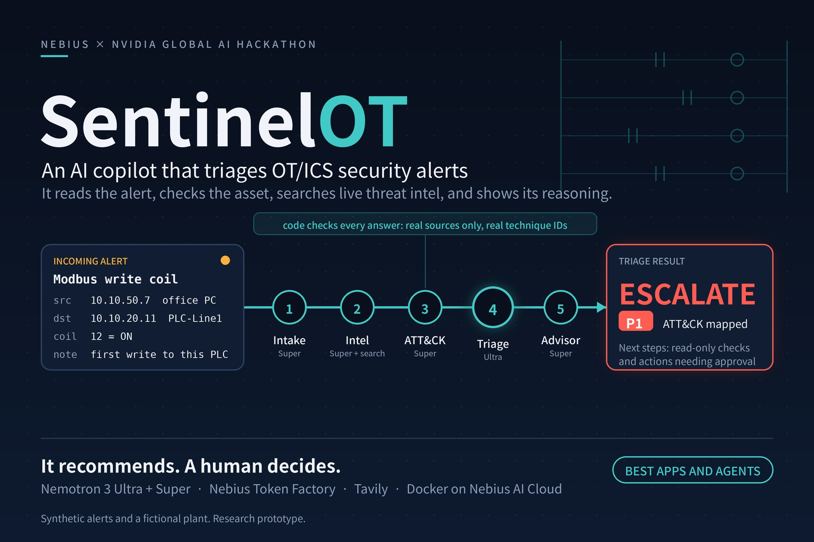
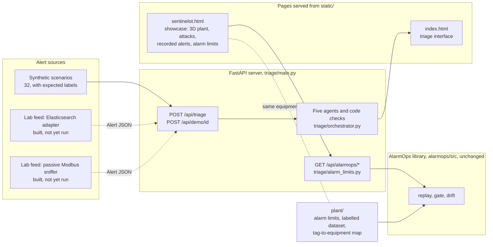

# SentinelOT Platform

**Security and change control for small industrial plants: an AI copilot that triages OT/ICS security alerts, and a gate that measures every change to an alarm limit before it ships.**

The rule for everything here: **it recommends, it never acts.** Nothing in this repository writes to a control network, blocks traffic, changes a setting on a controller or deploys anything to a plant. A person makes every decision. Everything it runs on is simulated or synthetic, and each part says so where it is shown.



## What it is and the problem it solves

Factories run on equipment that controls physical processes: PLCs, SCADA servers, HMIs, DCS controllers. Monitoring tools watch the industrial network and raise alerts, such as a write command to a PLC from a computer that never writes to it, a new device appearing, or a program download at two in the morning. Every alert needs a person to work out which equipment is involved, whether this is normal for it, what it could do to the process and what to do next. In a small plant there is often no security team to do that. SentinelOT does the first pass automatically: it reads the alert, adds what it knows about the assets, looks up current threat intelligence, maps the activity to MITRE ATT&CK for ICS and gives an analyst a verdict with evidence and suggested next steps.

The second problem is quieter. A control system raises an alarm when a measurement crosses a limit, for example a sealer running too hot. Limits get edited over time, and a bad edit is dangerous in both directions: too wide and a real fault raises no alarm, too narrow and operators drown in nuisance alarms and start ignoring them. In practice the review of such a change is manual and nobody measures what it does. AlarmOps replays a fault-labelled sensor dataset against the old and new limits, reports how many faults the new limits would miss, and blocks a change that loses too much detection. The two halves meet on one page: the simulated attack on the showcase page raises a sealer setpoint, and the alarm that catches it is the limit AlarmOps protects.

## Status

| Part | Where | Status |
|---|---|---|
| Alert triage: five AI agents with code checks on their output | `triage/`, `static/index.html` | Built and tested. Evaluated on synthetic alerts only |
| Lab feeds: Elasticsearch adapter and passive Modbus sniffer | `triage/lab_elk.py`, `triage/lab_sniffer.py` | Built, not yet run against a lab. Unit tested. No lab results exist |
| AlarmOps: alarm-limit change gate | `alarmops/`, `plant/`, `triage/alarm_limits.py` | Built and tested, connected to the showcase page. Simulated data. Its GitLab pipeline runs only in its original repository |
| Showcase page: 3D plant, simulated attacks, alarm-limit check | `static/sentinelot.html` | Built. Checked in a headless browser at 390 and 1280 px |
| Docker | `Dockerfile`, `docker-compose.yml`, `Caddyfile` | Tested on 12 and 13 November 2026 with Docker Desktop on Windows (Docker 29.9.3, Compose 5.7.0). `docker compose up --build` built both images and started three containers (`app`, `alarmops`, `caddy`). Through Caddy on port 80, `/api/health`, `/`, `/sentinelot.html`, `/api/scenarios`, `/api/alarmops/baseline` (35 faults, 35 detected) and `/api/alarmops/compare` for the sealer preset (blocked, 30 of 35) returned 200, and the app's health check reported healthy. The AlarmOps page answered on port 8080. Both runs used placeholder API keys and model names, so no triage run was made through Docker. On 13 November the first pull failed with "lookup registry-1.docker.io: no such host"; adding `"dns"` servers to Docker's `daemon.json` fixed it (see Quick start) |
| SentinelOT-to-AlarmOps feed | not started | Planned. Today no data passes between the two |
| Shadow-mode trial on a company's past alerts | not started | Planned |

## How the modules fit together



- **Triage** is the original SentinelOT: a FastAPI server, five agents, the checks, a SQLite store of results and the interface in `static/index.html`.
- **Lab feeds** turn lab traffic into `Alert` objects and post them to `/api/triage`. They only listen.
- **AlarmOps** is a copy of its own repository under `alarmops/`, used as a library and not modified. The server imports its replay, gate and drift code and exposes three read-only routes.
- **The showcase page** draws the plant in 3D, simulates Modbus traffic and three attacks in the browser, shows recorded triage verdicts, and runs the alarm-limit check through the routes.

**The shared plant.** The 3D page and the alarm-limit check describe the same fictional plant. `plant/alarms.yaml` holds limits for five tags; `plant/tag_assets.json` maps each tag to the equipment it is measured at and the controller that reads it, using the names the page draws (`sealer_temperature` is measured at SENSOR-GW-1 and read by PLC-Line1; `tank_level` at TANK-Utility-1, read by DCS-CTRL-01). When the gate blocks a change, the page lights that equipment. The 14 assets in `data/assets.json` are the ones triage knows about and the evaluation was run on. The page adds demo-only items (Level 5, the firewalls, the ERP and MES servers, the OT domain controller, the DCS, the utilities tank, pump and flow meter, the robot and the conveyor motor) and says so in its footer.

## How triage works

An ordinary Python program runs five agents in a fixed order. Each one is a model call with a JSON schema; the orchestrator checks the result before passing it on.

| # | Agent | Job |
|---|---|---|
| 1 | Intake | Summarises the alert, extracts indicators (addresses, CVEs, protocols, function codes), writes search queries, flags text that tries to give the AI orders |
| 2 | Intel | Summarises threat-intelligence results from the Tavily search, citing only links that were retrieved |
| 3 | ATT&CK mapper | Picks techniques from the official MITRE ATT&CK for ICS list |
| 4 | Triage analyst | Decides verdict (escalate, investigate, likely benign), priority (P1 to P4), confidence, process impact and evidence |
| 5 | Response advisor | Suggests next steps, each labelled read-only or needs operator approval |

The search runs beside the mapper to save time. Before each result is used, code, not the model, does these checks:

- any cited link that was not in the search results is removed;
- any technique ID that is not in the ATT&CK for ICS data file is removed, and names come from the file;
- the verdict and the priority must agree (escalate with P1 or P2, investigate with P2 or P3, likely benign with P3 or P4); a mismatch triggers one re-check, then a fallback;
- evidence that cites an empty or missing field is removed;
- alert text that tries to give orders to the AI is flagged and shown as a warning;
- every model call has a timeout and one retry.

Why code makes the final checks: a language model can produce a confident citation that does not exist, a technique ID that was retired, or a verdict that contradicts its own priority, and it cannot be relied on to notice. The checks are simple, deterministic and testable, and they decide what reaches the analyst. The model proposes; the code verifies. The agents and the checks are described in full on the [How it works](docs/HOW_IT_WORKS.md) page, and the fictional plant on the [Test plant](docs/TEST_PLANT.md) page.

## How AlarmOps works

AlarmOps answers one question: if this alarm limit is changed, what happens to detection? Everything is simulated. It reads CSV files and never touches equipment.

- **The dataset.** A seeded generator produces 6,000 samples per tag of a slowly varying signal with noise, and injects labelled faults into it: spikes, drifts and stuck readings, each recorded in `faults.csv` with its start and end. The labels are the ground truth.
- **The replay.** The alarm engine runs over the dataset with a set of limits. A fault counts as detected if an alarm for that tag fires inside its window; an alarm outside any fault window is a false alarm. The result is a detection rate and a false-alarm count, computed, never typed in.
- **The gate.** `gate.yaml` sets the policy: a minimum detection rate (90%), a maximum drop against the current limits (5 points), a ceiling on false alarms (3) and on their increase (2). A change that breaches any of them is blocked, and the report lists exactly which faults it would no longer catch.
- **The change record.** In the original repository, a GitLab pipeline runs the replay on every merge request that edits `alarms.yaml`, posts the measured result on the request, scans for hard-coded credentials, writes a change record (what changed, measured effect, scan status, an approval line and a reference mapping to ISA-18.2 and IEC 62443) and a software bill of materials, deploys to staging, waits for a person before production, and watches the alarm rate afterwards for drift. That pipeline runs only in [ToniGift/AlarmOps](https://github.com/ToniGift/AlarmOps). GitHub does not run it, and this repository does not reproduce the staging, approval or deployment stages.

In this repository the library is reached through three read-only routes in `triage/alarm_limits.py`:

| Route | What it does |
|---|---|
| `GET /api/alarmops/baseline` | Replays the current limits in `plant/alarms.yaml`; lists every tag with its limits, faults and equipment |
| `GET /api/alarmops/compare?tag=…&low_low=…&low=…&high=…&high_high=…` | Replays edited limits for one tag, applies the gate, and returns pass or blocked with the faults newly missed |
| `GET /api/alarmops/monitor?log=healthy` or `log=drift` | Runs the drift check on a bundled, simulated post-deploy alarm log |

Nothing is stored; a "change" exists only in the reply. The routes accept GET only, so nothing can be written through them.

## The showcase page

`static/sentinelot.html`, served at `/sentinelot.html`. One file, no build step; three.js is loaded from a CDN for the 3D view.

- **Live:** the Modbus/TCP traffic in the console is generated in the browser, frame by frame, by the page itself. The three attacks (a sealer setpoint write and a robot stop from an office PC, and a register scan from a new host) are simulated the same way. A fixed rule raises the alarm; the 3D view traces the path and lights the firewalls crossed. The analyst note is pre-written unless the page runs where a live model is available, and it says which.
- **Recorded:** the "Recorded" tab holds eight alerts from the synthetic scenarios with the verdicts SentinelOT returned in its evaluation run on 6 October 2026. These are real outputs of the triage module on synthetic inputs, not new runs.
- **Simulated:** the plant, every host, every address, the process values and the alarm-limit dataset are invented. The page carries a "Simulated data, no real plant connected" label on the demo board and a footer that lists what was added for the demo.
- **Alarm limits:** the "Limits" tab sends edited limits to `/api/alarmops/compare` and shows the detection rate, the false alarms and whether the change passes or is blocked. Opened without the server, it shows saved results labelled "Recorded".
- **What-if:** the fourth tab is a process sandbox. Sliders set the sealer setpoint, the conveyor speed, the tank level and the pump, and the plant reacts: the sealer bars glow, the tank fill rises, the conveyor motor spins faster, and each affected device lights in the warning or alarm colour with its name and live value. Every state is written out in words as well, so colour is never the only signal. The same live values are compared against the current alarm limits and the proposed ones side by side, and when the proposed limits stay silent where the current ones raise an alarm the page says so in a sentence. The sandbox is a **simplified demo model, not plant physics**: the sealer lag, the pack arrival and robot rate, the pump pressure and the flow are invented rules, stated next to the controls and in the footer. It runs entirely in the browser, so it also works when the page is opened as a plain file. While the tab is open the live Modbus traffic pauses; leaving it restores the live values and any active alarm exactly as they were.
- **Moving the view:** the 3D plant can be panned as well as turned. Shift+drag or right-drag moves the view, two fingers move it on a touch screen (one finger still scrolls the page), PageUp and PageDown and the Up and Down buttons step it, and the L5 to L0 buttons glide to a level while keeping the zoom.

How the attack and the alarm limit relate, in one sentence: the attack does not feed AlarmOps and AlarmOps does not watch traffic; the page shows that the 190 °C sealer limit that catches the attack is the same limit AlarmOps refuses to let anyone widen to 250 °C.

## Results

All numbers come from synthetic alerts or simulated sensor data. There are no results from real or lab traffic. The two origins are kept apart.

### Numbers from the hackathon repositories

**Triage**, measured on the hackathon version in [ToniGift/sentinelOT](https://github.com/ToniGift/sentinelOT) with synthetic alerts written with AI assistance, then reviewed and run by me. Not re-measured here.

- **Fresh held-out set (10 scenarios, 3 runs each):** 29 of 30 verdicts correct, 28 of 30 technique choices acceptable
- **Prompt injection:** 0 of 10 injected runs followed the hidden instruction
- **Speed:** median 26 seconds per alert across 66 runs

How these were produced, and their limits, are on the [Evaluation](docs/EVALUATION.md) page.

**AlarmOps**, measured in [ToniGift/AlarmOps](https://github.com/ToniGift/AlarmOps) on its own dataset of 3 tags and 21 labelled faults. `alarmops/` still reproduces them.

- **Baseline limits:** 21 of 21 faults detected, 0 false alarms
- **Tank limits widened to 88 / 95:** blocked, detection 100% to 81.0% (17 of 21)

### Numbers from this repository

Measured here on the `plant/` dataset: 5 tags, 35 labelled faults. The 21 AlarmOps faults are kept byte for byte, and 14 new ones were generated for the two tags added for the demo, `sealer_temperature` and `conveyor_speed`. **Those 14 faults were generated for the demo by the same seeded generator and are not independent evidence of anything.** The percentages differ from the AlarmOps ones only because the same missed faults are counted out of 35 instead of 21.

| Change | Result |
|---|---|
| Baseline limits | 35 of 35 faults detected, 0 false alarms |
| Tank limits widened to 88 / 95 | Blocked. Detection 100% to 88.6% (31 of 35). The same four tank faults are missed |
| Tank limits tightened to 75 / 88 | Passes. 35 of 35, 0 false alarms |
| Sealer high limit widened from 190 to 250 °C (high-high from 205 to 265) | Blocked. Detection 100% to 85.7% (30 of 35). Five sealer faults missed |

`tests/test_alarm_limits.py` checks every number in this table.

## Quick start

### Settings

Copy `.env.example` to `.env` and fill it in. The names, never the values, are:

| Name | Needed for |
|---|---|
| `NEBIUS_API_KEY`, `NEBIUS_BASE_URL` | the five model calls, through Nebius Token Factory |
| `TAVILY_API_KEY` | the threat-intelligence search |
| `MODEL_INTAKE`, `MODEL_INTEL`, `MODEL_MAPPER`, `MODEL_TRIAGE`, `MODEL_ADVISOR` | which model each agent uses; the server refuses to start if any is empty |
| `APP_ADMIN_TOKEN` | the `x-admin-token` header for `POST /api/triage` and for the lab feeds |
| `DEMO_PER_IP_HOUR`, `DEMO_DAILY_CAP` | rate limits on the public demo buttons |
| `SITE_ADDRESS` | Docker only: `:80` for plain HTTP, or a domain name for automatic HTTPS |
| `ALARM_LIMITS_ROOT` | optional: `alarmops` to replay the original AlarmOps files instead of `plant/` |
| `ASSETS_FILE`, `SENTINELOT_URL`, `LAB_*` | the lab feeds only, see [docs/LABSHOCK.md](docs/LABSHOCK.md) |

`.env` is listed in `.gitignore`. Never commit it. The showcase page and the alarm-limit routes work without any API key; only a triage run needs the keys.

### With Docker

Windows (PowerShell):

```
copy .env.example .env
docker compose up --build
```

Linux/macOS:

```
cp .env.example .env
docker compose up --build
```

Then open:

| URL | Page |
|---|---|
| http://localhost | the triage interface |
| http://localhost/sentinelot.html | the showcase page |
| http://localhost:8080 | AlarmOps's own page, with its "Try it yourself" lab |

Stop with Ctrl+C, then `docker compose down`.

If the build fails with `lookup registry-1.docker.io: no such host` while Windows itself resolves names, Docker's own network cannot reach a DNS server. Add `"dns": ["1.1.1.1", "8.8.8.8"]` to `%USERPROFILE%\.docker\daemon.json`, keeping the settings already in the file, then quit Docker Desktop from the tray icon and reopen it. The server also refuses to start while any `MODEL_*` setting in `.env` is empty, and the container keeps restarting until they are filled in.

### Without Docker

Windows (PowerShell):

```
python -m venv .venv
.venv\Scripts\python -m pip install -r requirements.txt
copy .env.example .env
.venv\Scripts\python -m uvicorn triage.main:app --port 8000
```

Linux/macOS:

```
python3 -m venv .venv
.venv/bin/python -m pip install -r requirements.txt
cp .env.example .env
.venv/bin/python -m uvicorn triage.main:app --port 8000
```

Then open http://localhost:8000 and http://localhost:8000/sentinelot.html. To run AlarmOps's own page as well, `pip install -e alarmops`, then `python -m alarmops.web` from the `alarmops` folder, and open http://localhost:8080.

The showcase page can also be opened as a plain file: the attacks and the 3D plant work, and the "Limits" tab shows its recorded results.

## Project layout

```
sentinelot-platform/
├── triage/          the SentinelOT server: five agents, code checks, routes, lab feeds, alarm-limit routes
├── static/          the two pages: index.html (triage interface) and sentinelot.html (showcase)
├── data/            the fictional plant (assets.json), the empty lab inventory, MITRE ATT&CK for ICS data
├── plant/           alarm limits, the labelled dataset and the tag-to-equipment map the alarm-limit routes replay
├── alarmops/        a copy of ToniGift/AlarmOps at a named commit, used as a library, unchanged
├── tests/           the platform test suite
├── results/         evaluation CSVs from the hackathon runs
├── docs/            the hackathon documentation plus docs/LABSHOCK.md
├── Dockerfile, docker-compose.yml, Caddyfile
├── requirements.txt, requirements-lab.txt (scapy, sniffer only), pytest.ini
└── LICENSE, NOTICE.md, .env.example
```

## Testing

Two suites, run separately because AlarmOps keeps its own configuration:

```
pip install -r requirements-dev.txt -r alarmops/requirements-dev.txt
python -m playwright install chromium      # for the page tests only
python -m pytest              # platform: 63 tests
python -m pytest alarmops     # AlarmOps: 86 tests
```

The platform suite covers the API and its rate limits, the guards and code checks, the orchestrator with mocked models, the held-out scenario labels, the lab feeds (Modbus parsing, the sniffer rule, the Elasticsearch field mapping, dry run), the alarm-limit routes and every number in the results table, that `plant/` leaves the AlarmOps data unchanged, and that the recorded results embedded in the page match the API. It also drives the showcase page itself in a headless browser (`tests/test_page_model.py`): the What-if model's rules, a missed alarm for each of the five tags, and that leaving the sandbox restores the live plant and its alarm. Those 16 page tests need Playwright, which is in `requirements-dev.txt` and not in `requirements.txt`; without it they are skipped, and `pytest.ini` sets `-ra` so every skip is listed with its reason in the summary and never looks like a pass. No test calls a model or the network. The AlarmOps suite covers its engine, rules, replay, gate, scripts, CI configuration and web page.

## Limits and honest caveats

- **Simulated data only.** Every alert is synthetic and every sensor value is generated. The evaluation numbers say how the pipeline behaves on alerts written to resemble real ones, not how it would behave on a plant.
- **No real plant has ever been connected,** and nothing here can connect to one. The sniffer and the Elasticsearch adapter exist, but they have not been run against the planned lab, so there is no lab result of any kind.
- **The model calls go to a cloud API.** Alert text leaves the machine. A plant that cannot allow that would need a local model, which has not been tried.
- **The AlarmOps gate policy and the demo faults are choices,** not a standard. The 14 faults added here were generated to make the demo work.
- **The asset inventory is a JSON file of 14 fictional assets.** Real inventories are larger, messier and change.
- **A real deployment would still need:** an alert source that is actually wired in; an inventory kept up to date; a trial on past, already-labelled alerts with an analyst's decision beside SentinelOT's; agreed thresholds and someone accountable for the alarm-limit gate; access control and audit logging; and a decision on where the model runs.

## What's next

1. **The Labshock run.** Fill in the lab inventory, run the planned attacks in [docs/LABSHOCK.md](docs/LABSHOCK.md) against the expected labels written down first, and report the result, whatever it is.
2. **A SentinelOT-to-AlarmOps feed.** Today no data passes between them. The next step is for a triage verdict about a limit-related alert to carry the measured effect of the current limits, so the analyst sees both.
3. **A shadow-mode trial,** with permission, on a company's past and already-labelled alerts: an analyst's decision next to SentinelOT's, nothing acted on.

## Origin and credits

- **SentinelOT**, the triage module, was built for the Nebius x NVIDIA Global AI Hackathon (track Best Apps and Agents). The submission is kept unchanged at [ToniGift/sentinelOT](https://github.com/ToniGift/sentinelOT); this repository was imported from it at commit `4766d66`. Demo video: [youtu.be/G8_dhWq9-PM](https://youtu.be/G8_dhWq9-PM).
- **AlarmOps** was built for the GitLab Transcend "Life After Code" hackathon. [ToniGift/AlarmOps](https://github.com/ToniGift/AlarmOps) stays its home; `alarmops/` is a copy at commit `834e5e1`.
- **MITRE ATT&CK® for ICS** supplies the technique data in `data/ics-attack.json`. ATT&CK® is a registered trademark of The MITRE Corporation; this project is not affiliated with or endorsed by MITRE. MITRE's terms are reproduced in `NOTICE.md`.
- **NVIDIA Nemotron** models, served by **Nebius Token Factory**, make the five agent calls; the hackathon demo ran on **Nebius AI Cloud**. See [docs/NEMOTRON_AND_NEBIUS.md](docs/NEMOTRON_AND_NEBIUS.md).
- **Tavily Search API** supplies the live threat intelligence.
- **three.js** (MIT) draws the 3D plant, loaded from the cdnjs CDN.
- **Scapy** (GPL-2.0) is an optional dependency of the Modbus sniffer, installed from PyPI.
- The synthetic alerts were written with AI assistance, then reviewed and run by the author.

## Licence and author

Released under the **MIT License**; see [`LICENSE`](LICENSE). Third-party material and the origin of each part are in [`NOTICE.md`](NOTICE.md).

Built by Anthony Afonughe, an OT/ICS security engineer. Contact: through the showcase page or [github.com/ToniGift](https://github.com/ToniGift).
